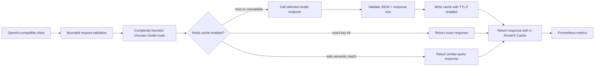

# LLM Cache & Semantic Routing Middleware for Low-Latency Serving

A local OpenAI-compatible proxy with Redis exact-response caching, context-constrained semantic reuse for deterministic requests, heuristic fast/reasoning model selection, and Prometheus metrics.

## Workflow



## Quick start

Configure at least one model endpoint. Caching is off by default.

```sh
export FAST_MODEL_URL='http://localhost:8001/v1/chat/completions'
export FAST_MODEL_NAME='small-instruct'
export REASONING_MODEL_URL='http://localhost:8002/v1/chat/completions'
export REASONING_MODEL_NAME='reasoning-model'
docker compose up --build
```

The proxy listens on `127.0.0.1:8083`; its OpenAI-compatible endpoint is `POST /v1/chat/completions`, health is `/health`, and metrics are `/metrics`. Configure `UPSTREAM_API_KEY` if both upstreams accept the same bearer credential. Streaming is currently rejected.

To opt in to Redis caching, set `CACHE_ENABLED=true` and configure Redis access, TTL, and similarity threshold. Cached prompts and responses are stored in Redis until TTL expiry. Do not enable caching for sensitive data unless Redis access, retention, encryption, and tenant isolation have been reviewed.

## Routing and cache behavior

- A simple word-count/feature heuristic selects the fast endpoint below `FAST_ROUTE_TOKEN_THRESHOLD`; other requests use the reasoning endpoint. It is a transparent baseline, not an ML classifier.
- If only one complete route is configured, it is used as the fallback.
- Exact cache keys include the effective model and entire request payload.
- Cache lookups and writes require explicit `temperature: 0`, `n: 1` (or omitted), no tools, and no response format. Semantic reuse uses token-set cosine similarity, and requires matching system/history context and effective model.
- Similarity and semantic caching can return an answer generated for a different but similar question. Tune conservatively and review suitability for the application.

See [architecture](docs/ARCHITECTURE.md), [cache behavior](docs/CACHE_AND_ROUTING.md), [deployment](docs/DEPLOYMENT.md), and [development](docs/DEVELOPMENT.md).
