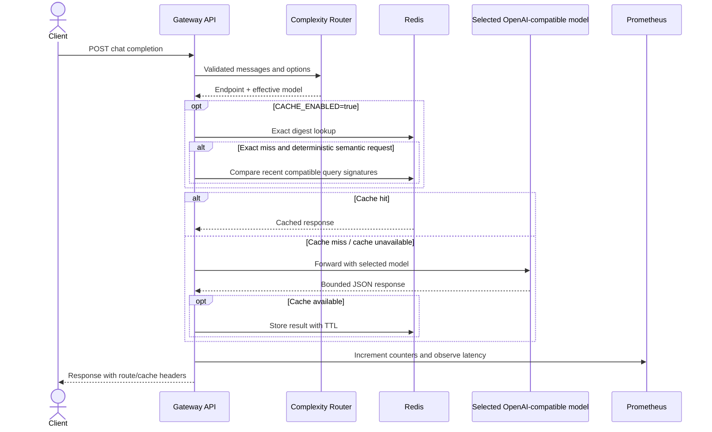

# Architecture

## Request path

1. **API boundary** reads a bounded request body, validates messages, and rejects streaming.
2. **Router** counts query tokens plus small feature weights and selects the configured fast or reasoning endpoint.
3. **Cache** optionally checks a SHA-256 exact key, then checks recent entries for token-set cosine similarity under the same effective model and matching conversation context.
4. **Provider adapter** forwards the request to a configured endpoint with a bounded timeout, no redirects, and capped response size.
5. **Metrics** record request route/status, cache outcome, latency, and in-flight count without prompt labels.

## Known limits

There is no authentication, tenant isolation, streaming, circuit breaker, distributed rate limit, learned router, or Redis vector index. Similarity uses a bounded recent-key list and token overlap; it is not embedding-based. Redis errors fall back to the upstream model. Process metrics are local to each replica.
